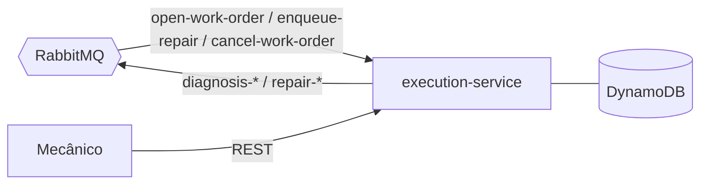

# oficina-execution-service

Microsserviço de **Execução e Produção** da oficina. Gerencia a fila de trabalho dos mecânicos, o diagnóstico e o reparo, e comunica cada etapa ao `os-service`.

## Responsabilidades

- Abrir a ordem de trabalho quando a Saga solicita.
- Expor a fila de execução, priorizando o que já está em reparo e, depois, o mais antigo.
- Registrar início e conclusão do diagnóstico e do reparo.
- Registrar falha no reparo, o que dispara a compensação da Saga.
- Cancelar a ordem de trabalho quando a OS é desfeita.

## Tecnologias

NestJS 11, TypeScript, DynamoDB (AWS SDK v3), RabbitMQ, Jest, Cucumber, New Relic, Docker, Kubernetes.

**Por que DynamoDB (NoSQL):** a ordem de trabalho é um documento único, lido e gravado sempre pelo id da OS, com uma linha do tempo de tamanho variável dentro dele. Não há junções nem transações entre registros, e o acesso por chave escala sem administração de servidor.

## Arquitetura

Clean Architecture: `domain` (agregado `WorkOrder` e seus estágios), `application` (comandos da Saga e ações do chão de oficina), `infrastructure` (DynamoDB e RabbitMQ) e `presentation` (controller REST).



## Participação na Saga

Estágios: `AWAITING_DIAGNOSIS` → `IN_DIAGNOSIS` → `AWAITING_APPROVAL` → `REPAIR_QUEUED` → `IN_REPAIR` → `COMPLETED`, com os desfechos `FAILED` e `CANCELLED`.

| Recebe | Publica |
|---|---|
| `execution.command.open-work-order` | `work-order-opened` ou `work-order-open-failed` |
| ação do mecânico no diagnóstico | `diagnosis-started`, `diagnosis-completed` |
| `execution.command.enqueue-repair` | `repair-queued` ou `repair-failed` |
| ação do mecânico no reparo | `repair-started`, `repair-completed` ou `repair-failed` |
| `execution.command.cancel-work-order` | — |

## Execução local

```bash
docker compose up --build
```

A API sobe em `http://localhost:3003` e o Swagger em `http://localhost:3003/docs/execution`. Localmente o serviço usa o DynamoDB Local e cria a tabela na inicialização. Para o fluxo completo, use o `docker-compose.yml` em `oficina-infra-k8s/local`.

As rotas exigem o token administrativo emitido pelo `os-service` (`POST /auth/login`).

## Testes

```bash
npm run test:cov
```

```bash
npm run test:bdd
```

Cobertura atual: **98% de linhas** (15 testes) e 3 cenários BDD: diagnóstico e reparo concluídos, reparo sem aprovação recusado e falha durante o reparo.

## Deploy

Mesma pipeline dos demais microsserviços: qualidade em todo pull request, deploy em `oficina-hml` a partir de `develop` e em `oficina-prod` a partir de `main`. A tabela `oficina-work-orders-<ambiente>` é criada pelo repositório `oficina-infra-db` e o acesso é concedido à role dos nós do cluster.

| Tipo | Nome |
|---|---|
| Secrets | `AWS_ACCESS_KEY_ID`, `AWS_SECRET_ACCESS_KEY`, `SONAR_TOKEN`, `RABBITMQ_URL`, `JWT_SECRET`, `NEW_RELIC_LICENSE_KEY` |
| Variables | `AWS_REGION`, `EKS_CLUSTER`, `SONAR_PROJECT_KEY`, `SONAR_ORGANIZATION` |

## Observabilidade

Logs em JSON com `correlationId` recebido das mensagens da Saga e agente New Relic com distributed tracing.

## APIs

Swagger em `/docs/execution` e collection do Postman em `oficina.postman_collection.json`.
